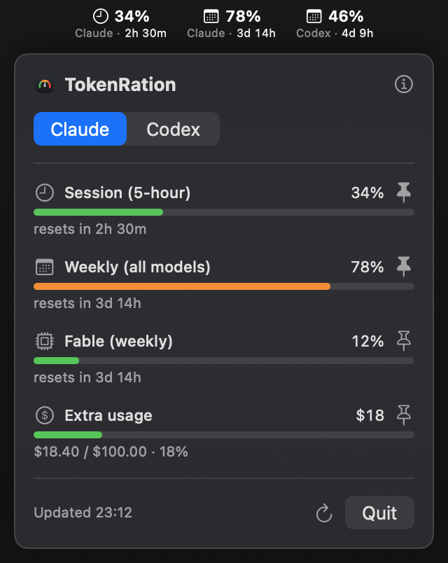
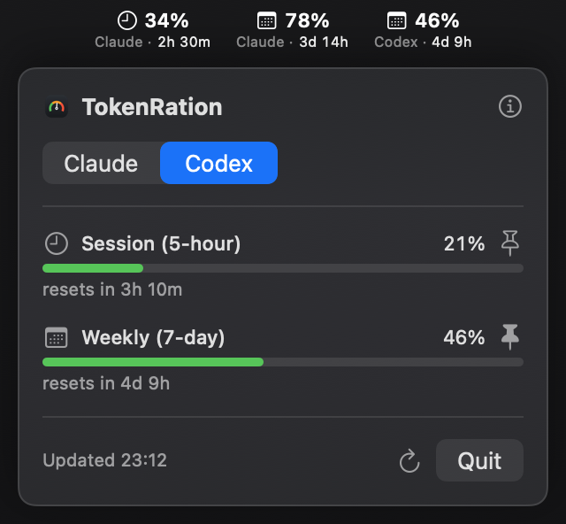

# TokenRation

A native macOS menu-bar app that shows your **Claude**, **Codex** and **Grok** usage at a glance — session and weekly windows, per-model limits (e.g. Fable, Codex-Spark), and spend/credits.

Pin one metric for a single icon, or several to stack them. Each kind of limit has the same icon whichever app it comes from, and when you pin metrics from more than one app, each names its app ahead of its countdown. All icons are template images, so they look right on light and dark menu bars. When more than one provider is set up, the panel gets a tab each.

 

## Install

Requires macOS 14+ and at least one of the Claude Code, Codex or Grok Build CLIs, signed in. Claude Code counts as set up once its `~/.claude` directory exists, Codex once you have signed in to it, which by default leaves its credentials in `~/.codex/auth.json`, and Grok Build once `grok login` has left its sign-in in `~/.grok/auth.json`. Whichever are set up are detected automatically when TokenRation launches, so one set up later appears after a relaunch. Once Codex is set up, TokenRation looks for `codex` in:

- the ChatGPT app in `/Applications`
- the VS Code extension
- Homebrew
- a `PATH` your login profile sets, read through your login shell when that is zsh or bash; with tcsh or csh, this `PATH` is not searched at all

A codex installed later in the ChatGPT app, the VS Code extension or Homebrew is found without a relaunch. One on a profile-set `PATH` is found at the next launch, if the profile answers within the few seconds TokenRation waits.

A codex that only `.zshrc` or `.bashrc` puts on `PATH`, as nvm usually arranges, is not found unless a file your login shell reads, such as `~/.zprofile` or `~/.bash_profile`, puts its directory on `PATH` too. One installed with npm starts when its `node` sits beside it or in Homebrew's directories.

Grok's numbers are your Grok allowance for the current week or month, which on a SuperGrok plan is shared by everything you use Grok for, plus any on-demand spend or prepaid credit. TokenRation uses `grok` where Grok Build's installer puts it, `~/.grok/bin/grok`, or where Homebrew's `grok-build` cask links it, `/opt/homebrew/bin` or `/usr/local/bin`.

```sh
brew tap MilosRandelovic/tokenration
brew trust MilosRandelovic/tokenration
brew install tokenration
```

On first launch, click **Always Allow** on the one-time Keychain prompt — that lets TokenRation read the access token the Claude Code CLI saved there. There's no separate sign-in.

## Agent access (MCP)

TokenRation bundles an MCP server so coding agents can check your remaining quota — e.g. before starting expensive work — without anyone hitting a usage API a second time. Register it once:

```sh
claude mcp add tokenration -- tokenration-mcp     # Claude Code
codex mcp add tokenration -- tokenration-mcp      # Codex
```

One tool, **`get_usage`** — takes no arguments and returns every limit, kept separate per provider (`claude`, `codex` and `grok` each with their own status, metrics and reset times), plus how old the reading is. Poll it as often as you like: it reads a local file, so calling it costs nothing upstream.

It **only reads** the app's published reading (`~/Library/Application Support/TokenRation/usage.json`) and never calls a usage API itself — MCP servers are spawned per session, so a fetching server would multiply request load across every concurrent agent. Results carry `ageSeconds` and `stale` so a caller can judge freshness; if the app isn't running, the data is simply old.

## Build from source

macOS 14+, Swift 6 (Xcode 16+):

```sh
make build                      # compile
make test                       # run the test suite
make format                     # format the sources (CI fails on unformatted code)
make app                        # TokenRation.app, ad-hoc signed (local use)
make release                    # distributable build; notarized with a Developer ID cert
swift run TokenRation           # run from source (dies with the shell — fine for a quick check)
```

Launch the built app with `open TokenRation.app`, or copy it to `/Applications` and start it from Finder/Spotlight. **Don't run `TokenRation.app/Contents/MacOS/TokenRation &` from a terminal** — that makes the app a child of the shell, so it is killed the moment the shell exits (silently, with no crash report). `open` detaches it properly. For a menu-bar app you want running all the time, add it to **System Settings ▸ General ▸ Login Items**.

## How it works

- **Claude data:** `GET https://api.anthropic.com/api/oauth/usage` — the same endpoint Claude Code's `/usage` uses. Polled every ~5 minutes, paused while the Mac sleeps or is offline, with exponential backoff and a long hold-off after a rate limit (all persisted, so restarts and wakes can't bypass it).
- **Codex data:** JSON-RPC `account/rateLimits/read` against a local `codex app-server` subprocess. The ChatGPT HTTP backend rejects non-client callers (403 bot protection), and going through the local CLI means no credential handling of our own and no model quota consumed.
- **Grok data:** the billing summary behind Grok Build's `/usage` screen, asked over HTTP with Grok Build's token while it is current. Grok's token lasts six hours, and Grok renews it whenever it runs; once it has expired, TokenRation starts `grok agent` with its update check off and asks it instead, which renews the token, so the next requests go over HTTP again.
- **Auth:** the Claude Code CLI stores an OAuth access token in your login Keychain (`Claude Code-credentials`); TokenRation reads that token via `/usr/bin/security` to authenticate the Claude request. Codex needs nothing — its own CLI is already signed in. Grok's token is read from `~/.grok/auth.json`. Credentials are **never written or refreshed** by TokenRation; the CLIs stay the only things that manage them.
- **Independence:** each provider polls on its own schedule with its own persisted backoff, so one being throttled or signed out never stalls the others.
- **Diagnostics:** every attempt and its outcome is logged to `~/Library/Logs/TokenRation.log` (rotated at 512 KB) for troubleshooting.

## Architecture

```
Sources/TokenRation/
├── Main.swift · AppDelegate.swift   entry point; wires providers + prefs + status bar
├── Provider.swift                   the providers: detection, and each kind of metric's icon
├── ProvidersModel.swift             one UsageModel per provider shown; tab selection
├── UsageModel.swift                 polling loop + state (per-provider, persisted backoff)
├── ClaudeUsageProvider.swift        /api/oauth/usage → DisplayMetrics
├── CodexUsageProvider.swift         codex app-server JSON-RPC → DisplayMetrics
├── CodexBinary.swift                locates the codex executable
├── GrokUsageProvider.swift          Grok billing over HTTP, or through grok agent → DisplayMetrics
├── RPCExchange.swift                one JSON-RPC exchange with a CLI over stdio
├── UsageProviding.swift             the provider protocol and UsageError
├── KeychainToken.swift              reads the Claude token via /usr/bin/security
├── Preferences.swift                which metrics are pinned
├── StatusBarController.swift        menu-bar item + the custom dropdown panel
├── UsagePanelView.swift             SwiftUI panel: tabs, meters, pins, states, About
├── UpdateChecker.swift              the GitHub release check
├── Log.swift                        the diagnostics log
├── RestoredSnapshot.swift           the last published reading, shown at a cold start
└── UsageSnapshot.swift              value types the UI renders

Sources/UsageState/                  shared state file format (app writes, MCP server reads)
Sources/TokenRationMCP/              the bundled stdio MCP server
```

## Releasing

Bump `SHORT_VERSION` in `scripts/common.sh`, add that version's section to `CHANGELOG.md`, and merge to `main`. The release workflow builds, tags, publishes the GitHub release with `TokenRation.zip`, and opens a pull request against the [tap](https://github.com/MilosRandelovic/homebrew-tokenration) updating the cask's version and checksum. Merging that PR makes the release installable.

The job **fails if the version is already tagged**, so every push to `main` either publishes a release or goes red — a green run always means something shipped.

Distributed as a Homebrew cask via the [homebrew-tokenration](https://github.com/MilosRandelovic/homebrew-tokenration) tap.

## License

MIT — see [LICENSE](LICENSE).
